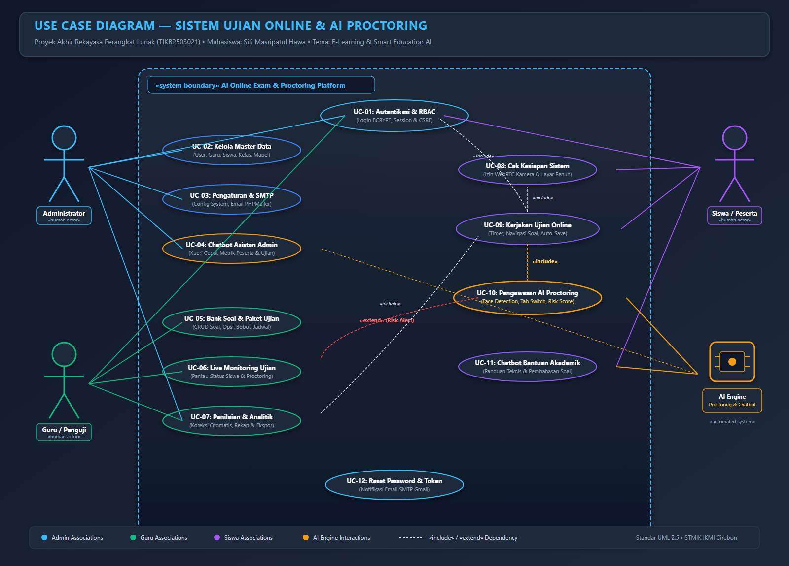
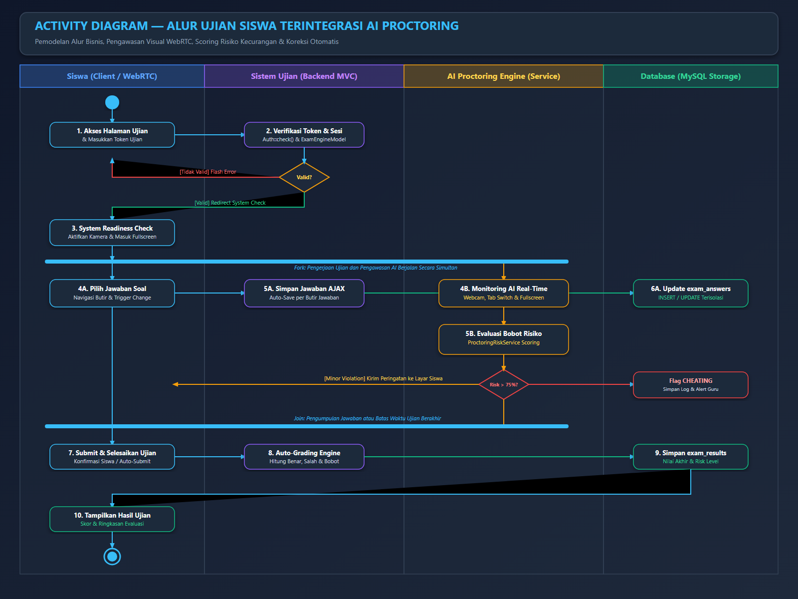
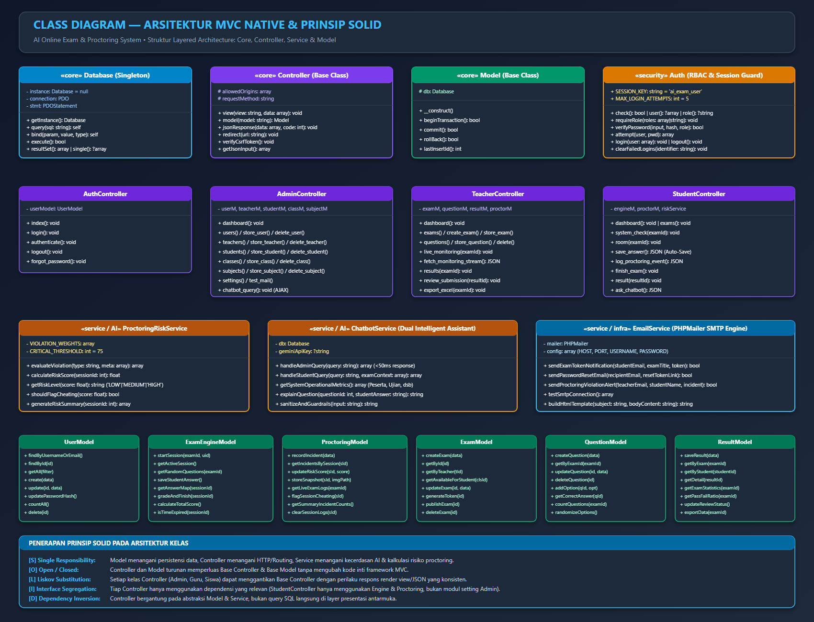
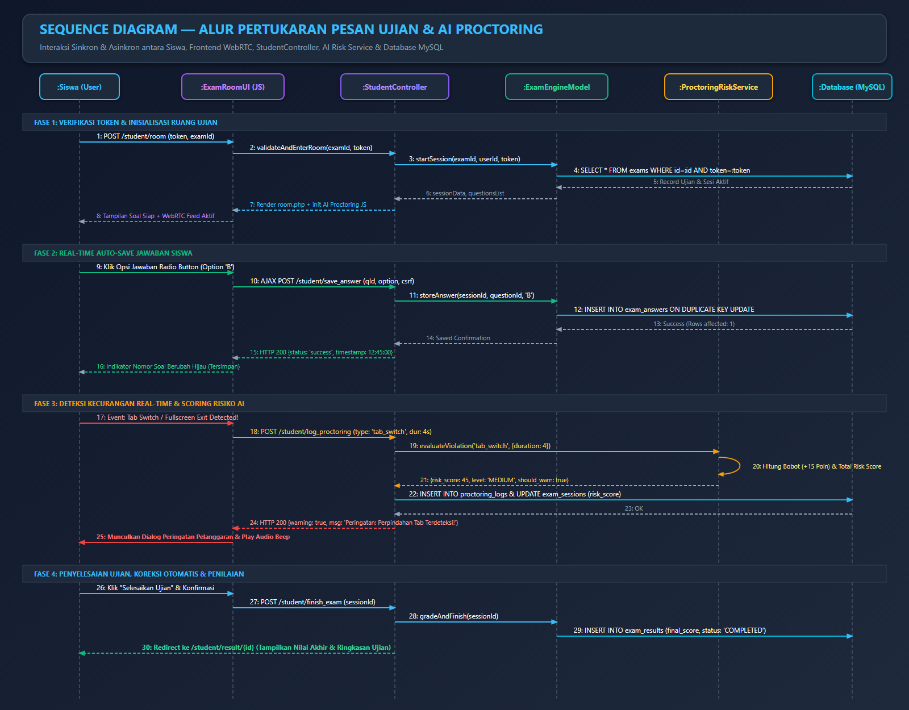

# DOKUMEN PERANCANGAN SISTEM & PEMODELAN UML (SDD)
## TAHAP 2: ARSITEKTUR SISTEM, PEMODELAN 4 DIAGRAM UML & PRINSIP SOLID

---

### IDENTITAS MAHASISWA & PROYEK
* **Mata Kuliah / Kode** : Rekayasa Perangkat Lunak (TIKB2503021) — Semester 3
* **Program Studi** : S1 Teknik Informatika / Rekayasa Perangkat Lunak
* **Institusi** : STMIK IKMI Cirebon
* **Dosen Pengampu** : Yudhistira Arie Wijaya, M.Kom., CDS.
* **Pengembang Mandiri** : Siti Masripatul Hawa (`Sitimasripatulhawa`)
* **Tema Topik Proyek** : *E-Learning & Smart Education AI*
* **Judul Aplikasi** : **AI Online Exam & Proctoring System with Dual Intelligent Chatbot Assistance**
* **Arsitektur Sistem** : Pure PHP 8.2 MVC Native (Model-View-Controller) & Service Layer Architecture
* **Target Luaran Tahap 2** : Dokumen SDD & 4 Gambar Diagram UML Lengkap (Use Case, Activity, Class, Sequence)

---

## DAFTAR ISI
1. [BAB I: Gambaran Umum Arsitektur Sistem](#bab-i-gambaran-umum-arsitektur-sistem)
2. [BAB II: Diagram 1 — Use Case Diagram & Skenario](#bab-ii-diagram-1--use-case-diagram--skenario)
3. [BAB III: Diagram 2 — Activity Diagram Alur Bisnis & AI Proctoring](#bab-iii-diagram-2--activity-diagram-alur-bisnis--ai-proctoring)
4. [BAB IV: Diagram 3 — Class Diagram Berorientasi Objek & Prinsip SOLID](#bab-iv-diagram-3--class-diagram-berorientasi-objek--prinsip-solid)
5. [BAB V: Diagram 4 — Sequence Diagram Alur Pertukaran Pesan](#bab-v-diagram-4--sequence-diagram-alur-pertukaran-pesan)
6. [BAB VI: Petunjuk Akses Berkas Gambar Diagram](#bab-vi-petunjuk-akses-berkas-gambar-diagram)

---

## BAB I: GAMBARAN UMUM ARSITEKTUR SISTEM

Aplikasi **AI Online Exam & Proctoring System** dibangun secara mandiri menggunakan arsitektur **3-Tier Pure PHP MVC (Model-View-Controller) Native** yang diperluas dengan **Service Layer**. Pemisahan peran arsitektural ini memastikan prinsip *Separation of Concerns* (SoC) dan mematuhi prinsip desain berorientasi objek **SOLID**:

```
+-----------------------------------------------------------------------------------+
|                           PRESENTATION TIER (VIEWS & UI)                         |
|  - HTML5, CSS3, Bootstrap 5.3, Bootstrap Icons, Chart.js                         |
|  - WebRTC Client (MediaDevices API, Canvas snapshot capture)                      |
|  - Vanilla JS Client Controllers (ai-proctoring.js, proctoring-camera.js, chatbot)|
+------------------------------------------+----------------------------------------+
                                           | HTTP Requests / AJAX JSON (CSRF Token)
                                           v
+-----------------------------------------------------------------------------------+
|                           APPLICATION TIER (ROUTER & CONTROLLERS)                 |
|  - App Router: Parsing URL & Dynamic Dispatcher                                   |
|  - AuthController: Login BCRYPT, Session Hardening, Brute-force Throttling        |
|  - AdminController: Master Data CRUD, SMTP Testing, Chatbot Metrik Operasional    |
|  - TeacherController: Question Bank, Exam Packages, Live Monitoring & Review      |
|  - StudentController: System Readiness Check, Exam Room, Auto-Save, Proctoring Log|
+---------------------+---------------------------------------+---------------------+
                      |                                       |
                      v                                       v
+------------------------------------+  +-------------------------------------------+
|          DATA ACCESS LAYER         |  |         DOMAIN SERVICE / AI LAYER         |
|  - UserModel, TeacherModel         |  |  - ProctoringRiskService:                 |
|  - StudentModel, ClassModel        |  |    * Violation Penalty Scoring            |
|  - ExamModel, QuestionModel        |  |    * Fraud Status Flagging                |
|  - ExamEngineModel, ResultModel    |  |  - ChatbotService:                        |
|  - ProctoringModel, SettingModel   |  |    * Rule-based & NLP Hybrid Response     |
|  - Base Model (Database Singleton) |  |    * Fast Metric Analytics (<50ms)        |
+---------------------+--------------+  |  - EmailService (PHPMailer SMTP Engine)   |
                      |                 +-------------------------------------------+
                      v
+-----------------------------------------------------------------------------------+
|                           DATABASE TIER (MYSQL / MARIADB)                         |
|  - PDO Parameterized Queries, InnoDB Engine, Relational Integrity & Transactions  |
+-----------------------------------------------------------------------------------+
```

---

## BAB II: DIAGRAM 1 — USE CASE DIAGRAM & SKENARIO

### 2.1 Visual Diagram
Berkas gambar diagram tersimpan dalam 2 format (Vektor SVG & Raster PNG):
* **PNG** : [`docs/diagrams/01_use_case_diagram.png`](diagrams/01_use_case_diagram.png)
* **SVG** : [`docs/diagrams/01_use_case_diagram.svg`](diagrams/01_use_case_diagram.svg)



### 2.2 Identifikasi Aktor
1. **Administrator (`«human actor»`)**: Pengelola level super yang bertanggung jawab atas master data institusi, manajemen akun pengguna, pengaturan lingkungan sistem, konfigurasi SMTP email, dan monitoring analitik lintas modul.
2. **Guru / Penguji (`«human actor»`)**: Pendidik yang berwenang menyusun butir soal, membuat paket jadwal ujian, memantau aktivitas pengerjaan siswa secara *real-time* via *Live Proctoring Feed*, serta melakukan penilaian dan rekapitulasi nilai.
3. **Siswa / Peserta (`«human actor»`)**: Peserta didik yang menjalani verifikasi kesiapan perangkat (*System Check*), memasukkan token ujian, mengerjakan soal dengan dukungan *auto-save*, diawasi oleh mesin proctoring, serta memanfaatkan *Student Academic Chatbot*.
4. **AI Engine (`«automated system»`)**: Subsistem cerdas otomatis yang mengeksekusi deteksi kecurangan visual, kalkulasi skor risiko pelanggaran secara *real-time*, dan pemrosesan kueri percakapan asisten cerdas (*Dual Chatbot*).

### 2.3 Matriks Use Case & Relasi
| ID | Nama Use Case | Aktor Terlibat | Relasi Ketergantungan |
|---|---|---|---|
| **UC-01** | Autentikasi & RBAC Multi-Role | Admin, Guru, Siswa | Dasar dari seluruh modul internal |
| **UC-02** | Kelola Master Data Sekolah | Admin | Independen |
| **UC-03** | Pengaturan Sistem & Mail SMTP | Admin | Independen |
| **UC-04** | Chatbot Asisten Operasional | Admin, AI Engine | Independen |
| **UC-05** | Bank Soal & Paket Ujian | Guru, Admin | Independen |
| **UC-06** | Live Monitoring & Proctoring Feed | Guru | Diperluas oleh UC-10 (`«extend»`) |
| **UC-07** | Penilaian Otomatis & Analitik | Guru, Admin | Termasuk UC-09 (`«include»`) |
| **UC-08** | Cek Kesiapan Sistem (WebRTC) | Siswa | Termasuk dalam UC-09 (`«include»`) |
| **UC-09** | Kerjakan Ujian & Auto-Save | Siswa | Termasuk UC-01, UC-08, UC-10 (`«include»`) |
| **UC-10** | Pengawasan AI Proctoring Real-time | Siswa, AI Engine | Memperluas UC-06 (`«extend»`) |
| **UC-11** | Chatbot Bantuan Akademik Siswa | Siswa, AI Engine | Opsional |
| **UC-12** | Reset Kata Sandi via Email | Admin, Guru, Siswa | Independen |

### 2.4 Skenario Use Case Utama (UC-09: Kerjakan Ujian & UC-10: AI Proctoring)
* **Aktor Utama** : Siswa & AI Engine
* **Prekondisi** : Siswa telah login ke sistem, status akun aktif, dan telah lulus verifikasi kamera WebRTC (UC-08).
* **Alur Normal (Main Flow)** :
  1. Siswa memilih jadwal ujian yang berstatus aktif pada dashboard.
  2. Siswa memasukkan token ujian yang valid.
  3. Sistem memvalidasi token dan menginisialisasi sesi ujian di tabel `exam_sessions`.
  4. Ruang ujian (`room.php`) dirender bersamaan dengan pengacakan butir soal dan opsi jawaban.
  5. Antarmuka mengaktifkan pemantau layar penuh (*fullscreen guard*) dan umpan kamera WebRTC di latar belakang.
  6. Siswa memilih jawaban pada salah satu butir soal; klien mengeksekusi AJAX *auto-save* tanpa merefresh halaman.
  7. Sistem menyimpan jawaban ke tabel `exam_answers` dan mengirimkan status sukses kembali ke klien.
  8. AI Proctoring Client memantau status fokus jendela, tab aktif, dan visual wajah peserta secara periodik.
  9. Siswa menyelesaikan seluruh soal atau timer ujian habis, lalu menekan tombol konfirmasi submit.
  10. Sistem menghitung skor secara otomatis dan mengarahkan siswa ke halaman ringkasan hasil ujian (UC-07).
* **Alur Alternatif (Alternative Flow - Pelanggaran Terdeteksi)** :
  * 8a. Siswa mencoba berpindah tab atau meminimalkan jendela browser (`visibilitychange` event).
  * 8b. Klien mengirimkan log pelanggaran ke `StudentController::log_proctoring_event()`.
  * 8c. `ProctoringRiskService` menambahkan bobot penalti (+15 poin) dan menghitung ulang total skor risiko.
  * 8d. Sistem memunculkan modal peringatan interaktif di layar siswa dan memutar audio peringatan.
  * 8e. Jika skor risiko kumulatif melampaui batas kritis (75%), status sesi ditandai sebagai `CHEATING` dan memicu alert merah pada dashboard *Live Monitoring* Guru.

---

## BAB III: DIAGRAM 2 — ACTIVITY DIAGRAM ALUR BISNIS & AI PROCTORING

### 3.1 Visual Diagram
* **PNG** : [`docs/diagrams/02_activity_diagram.png`](diagrams/02_activity_diagram.png)
* **SVG** : [`docs/diagrams/02_activity_diagram.svg`](diagrams/02_activity_diagram.svg)



### 3.2 Penjelasan Partisi (Swimlanes)
Activity Diagram dimodelkan ke dalam 4 jalur tanggung jawab (*swimlanes*):
1. **Siswa (Client / WebRTC)**: Berisi seluruh aktivitas interaksi pengguna di peramban, manipulasi DOM, penangkapan frame kamera WebRTC, dan penanganan event keyboard/mouse/layar.
2. **Sistem Ujian (Backend MVC)**: Berisi logika controller dalam memvalidasi input, mengendalikan siklus hidup sesi ujian, memproses permintaan AJAX auto-save, dan mengorkestrasi penilaian.
3. **AI Proctoring Engine (Service)**: Komponen kecerdasan buatan dan pemroses aturan risiko yang mengevaluasi keparahan setiap insiden kecurangan dan menentukan tingkat ancaman integritas akademik.
4. **Database (MySQL Storage)**: Layer persistensi data yang menyimpan status transaksi, snapshot log pelanggaran, dan rekaman nilai akhir.

### 3.3 Alur Kerja Paralel (Fork & Join)
Kunci keunggulan arsitektur ujian ini terletak pada percabangan **Fork-Join**:
* **Fork Bar**: Saat sesi ujian dimulai, sistem memecah alur menjadi 2 proses paralel simultan:
  - **Cabang A (Pengerjaan Ujian)**: Siswa bernavigasi antar nomor soal, memilih opsi jawaban, memicu event `change`, mengirimkan payload AJAX ke endpoint `/student/save_answer`, dan memperbarui status nomor soal menjadi hijau (tersimpan).
  - **Cabang B (Pengawasan AI Real-Time)**: Kamera pengawas mengambil snapshot secara periodik, mendeteksi ketiadaan wajah, kehadiran lebih dari 1 wajah, perpindahan tab, atau keluarnya mode fullscreen. Setiap pelanggaran dihitung oleh `ProctoringRiskService`. Jika skor risiko > 75%, status sesi diubah menjadi `SUSPECTED / CHEATING` dan notifikasi darurat dikirim ke guru.
* **Join Bar**: Kedua cabang bertemu kembali ketika siswa secara sadar menekan tombol "Selesaikan Ujian" atau ketika batas waktu mundur (countdown timer) telah mencapai 00:00:00.
* **Finalisasi**: Sistem mengeksekusi *Auto-Grading Engine*, menghitung butir benar, salah, dan nilai skala 0-100, mencatat rekapitulasi ke `exam_results`, lalu menampilkan skor final kepada siswa.

---

## BAB IV: DIAGRAM 3 — CLASS DIAGRAM BERORIENTASI OBJEK & PRINSIP SOLID

### 4.1 Visual Diagram
* **PNG** : [`docs/diagrams/03_class_diagram.png`](diagrams/03_class_diagram.png)
* **SVG** : [`docs/diagrams/03_class_diagram.svg`](diagrams/03_class_diagram.svg)



### 4.2 Struktur Kelas & Tanggung Jawab

#### 1. Core Framework Layer
* **`Database` (Design Pattern: Singleton)**:
  - Menjamin hanya terdapat satu koneksi database PDO selama siklus hidup request HTTP.
  - Method utama: `getInstance()`, `query($sql)`, `bind($param, $val, $type)`, `execute()`, `resultSet()`, `single()`, `rowCount()`.
* **`App` (Front Controller & Router)**:
  - Mengurai URL request (`index.php?url=...`), menentukan controller sasaran, memanggil method aksi, dan meneruskan parameter dinamis.
* **`Controller` (Abstract Base Class)**:
  - Menyediakan fondasi bagi seluruh web controller.
  - Method pembantu: `view($view, $data)`, `model($modelName)`, `jsonResponse($data, $code)`, `redirect($url)`, `verifyCsrfToken()`.
* **`Model` (Abstract Base Class)**:
  - Mengkapsulasi akses ke instance `Database` dan memfasilitasi transaksi basis data (`beginTransaction()`, `commit()`, `rollBack()`).
* **`Auth` & `Csrf` (Security Guards)**:
  - Mengelola sesi pengguna terenkripsi, RBAC role-checking, proteksi serangan brute-force, dan validasi token anti-CSRF per sesi.

#### 2. Controller Layer
* **`AuthController`**: Menangani otentikasi multi-role, validasi login, dan manajemen keluar sistem.
* **`AdminController`**: Menangani CRUD master data (pengguna, guru, siswa, kelas, mata pelajaran), konfigurasi sistem, dan antarmuka chatbot operasional.
* **`TeacherController`**: Mengelola bank butir soal, penjadwalan ujian, antarmuka *live monitoring*, dan review hasil ujian siswa.
* **`StudentController`**: Mengatur tahapan uji kesiapan perangkat, ruang ujian interaktif, penerimaan payload auto-save, pencatatan log proctoring, dan chatbot asisten akademik.

#### 3. Domain Service / AI Layer
* **`ProctoringRiskService`**:
  - Mengelola bobot pelanggaran: `tab_switch` (15 poin), `fullscreen_exit` (20 poin), `face_absent` (25 poin), `multiple_faces` (35 poin).
  - Menghitung skor risiko kumulatif (0 - 100), menentukan kategori risiko (`LOW`, `MEDIUM`, `HIGH`), dan mengevaluasi status kecurangan.
* **`ChatbotService`**:
  - Menangani kueri teks dari dua persona (*Admin Operational Assistant* dan *Student Academic Assistant*).
  - Menyediakan jawaban analitik metrik real-time (<50ms) dan penjelasan soal interaktif.
* **`EmailService`**:
  - Mengintegrasikan pustaka PHPMailer untuk pengiriman token ujian dan tautan pemulihan kata sandi melalui SMTP Gmail terenkripsi TLS.

#### 4. Model Persistence Layer
* Mengimplementasikan interaksi tabel spesifik: `UserModel`, `TeacherModel`, `StudentModel`, `ClassModel`, `SubjectModel`, `ExamModel`, `QuestionModel`, `ExamEngineModel`, `ResultModel`, `ProctoringModel`, dan `SettingModel`.

### 4.3 Pemetaan Prinsip SOLID pada Kode Aplikasi
1. **Single Responsibility Principle (SRP)**:
   - Setiap kelas hanya memiliki satu alasan untuk berubah. `ExamEngineModel` hanya fokus pada logika pengerjaan dan penilaian ujian, sedangkan `ProctoringRiskService` hanya fokus pada kalkulasi risiko kecurangan. Controller tidak menulis query SQL mentah.
2. **Open/Closed Principle (OCP)**:
   - Kerangka kerja dirancang terbuka untuk penambahan fitur tetapi tertutup untuk modifikasi kode inti. Menambahkan controller baru (misalnya `ParentController`) dilakukan dengan meng-extend `Controller` dasar tanpa memodifikasi `App.php` atau `Controller.php`.
3. **Liskov Substitution Principle (LSP)**:
   - Semua kelas turunan `Controller` (seperti `AdminController` atau `StudentController`) dapat menggantikan objek induknya tanpa merusak ekspektasi perilaku aplikasi (seperti kemampuan render view dan respons JSON).
4. **Interface Segregation Principle (ISP)**:
   - Setiap modul hanya menggunakan dependensi yang diperlukannya. `StudentController` tidak dibebani dependensi manajemen master data kelas atau pengaturan SMTP email institusi.
5. **Dependency Inversion Principle (DIP)**:
   - Komponen tingkat tinggi (Controller) tidak bergantung langsung pada implementasi tingkat rendah (driver database MySQL mentah), melainkan bergantung pada abstraksi layer `Model` dan `Database` singleton.

---

## BAB V: DIAGRAM 4 — SEQUENCE DIAGRAM ALUR PERTUKARAN PESAN

### 5.1 Visual Diagram
* **PNG** : [`docs/diagrams/04_sequence_diagram.png`](diagrams/04_sequence_diagram.png)
* **SVG** : [`docs/diagrams/04_sequence_diagram.svg`](diagrams/04_sequence_diagram.svg)



### 5.2 Rangkaian Interaksi Pesan (30 Tahapan Pesan)

#### Fase 1: Verifikasi Token & Inisialisasi Ruang Ujian
1. `Siswa -> ExamRoomUI`: Masuk ruang ujian dengan menginput token ujian.
2. `ExamRoomUI -> StudentController`: Mengirim request HTTP `POST /student/room/{id}` dengan payload token.
3. `StudentController -> ExamEngineModel`: Memanggil method `startSession($examId, $userId, $token)`.
4. `ExamEngineModel -> Database`: Mengeksekusi query validasi `SELECT * FROM exams WHERE id=:id AND token=:token`.
5. `Database --> ExamEngineModel`: Mengembalikan data ujian aktif.
6. `ExamEngineModel --> StudentController`: Mengembalikan objek sesi sah dan daftar pertanyaan teracak.
7. `StudentController --> ExamRoomUI`: Merender view `room.php` dan menginisialisasi skrip JavaScript AI Proctoring.
8. `ExamRoomUI --> Siswa`: Menampilkan antarmuka butir soal dan mengaktifkan umpan video kamera WebRTC.

#### Fase 2: Real-time Auto-Save Jawaban Siswa
9. `Siswa -> ExamRoomUI`: Mengklik opsi jawaban (misal memilih opsi 'B' pada butir soal nomor 3).
10. `ExamRoomUI -> StudentController`: Mengirim permintaan AJAX asinkron `POST /student/save_answer` dengan parameter token CSRF, ID sesi, ID butir soal, dan opsi terpilih.
11. `StudentController -> ExamEngineModel`: Memanggil `storeAnswer($sessionId, $questionId, 'B')`.
12. `ExamEngineModel -> Database`: Mengeksekusi statement `INSERT INTO exam_answers (...) ON DUPLICATE KEY UPDATE answer_option = 'B'`.
13. `Database --> ExamEngineModel`: Mengembalikan konfirmasi baris berhasil disimpan (`affectedRows = 1`).
14. `ExamEngineModel --> StudentController`: Mengonfirmasi status penyimpanan berhasil.
15. `StudentController --> ExamRoomUI`: Mengembalikan respons JSON HTTP 200 `{status: 'success', last_saved: '12:45:00'}`.
16. `ExamRoomUI --> Siswa`: Mengubah status indikator butir soal menjadi warna hijau bertanda tersimpan tanpa menginterupsi konsentrasi siswa.

#### Fase 3: Deteksi Kecurangan Real-Time & Scoring Risiko AI
17. `Siswa -> ExamRoomUI`: Siswa meninggalkan jendela ujian (berpindah tab atau aplikasi lain; event `visibilitychange` tertangkap).
18. `ExamRoomUI -> StudentController`: Mengirimkan payload insiden `POST /student/log_proctoring` `{type: 'tab_switch', duration: 4s}`.
19. `StudentController -> ProctoringRiskService`: Memanggil `evaluateViolation('tab_switch', ['duration' => 4])`.
20. `ProctoringRiskService -> ProctoringRiskService`: Menghitung bobot penalti (+15 poin) dan mengkalkulasi ulang total skor risiko.
21. `ProctoringRiskService --> StudentController`: Mengembalikan evaluasi risiko `{risk_score: 45, level: 'MEDIUM', should_warn: true}`.
22. `StudentController -> Database`: Menyimpan log ke tabel `proctoring_logs` dan mengupdate field `risk_score` di `exam_sessions`.
23. `Database --> StudentController`: Konfirmasi rekaman tersimpan.
24. `StudentController --> ExamRoomUI`: Mengembalikan respons JSON `{warning: true, message: 'Peringatan: Perpindahan tab terdeteksi!'}`.
25. `ExamRoomUI --> Siswa`: Menampilkan modal peringatan pelanggaran di tengah layar dan memutar nada peringatan audio.

#### Fase 4: Penyelesaian Ujian, Koreksi Otomatis & Penilaian
26. `Siswa -> ExamRoomUI`: Menekan tombol "Selesaikan Ujian" dan mengonfirmasi dialog validasi akhir.
27. `ExamRoomUI -> StudentController`: Mengirimkan request `POST /student/finish_exam`.
28. `StudentController -> ExamEngineModel`: Memanggil fungsi `gradeAndFinish($sessionId)`.
29. `ExamEngineModel -> Database`: Menghitung butir benar/salah, mengunci sesi, dan menyimpan nilai akhir ke tabel `exam_results`.
30. `StudentController --> Siswa`: Mengalihkan tampilan siswa ke halaman `/student/result/{id}` yang memuat skor akhir, persentase kelulusan, dan ringkasan evaluasi.

---

## BAB VI: PETUNJUK AKSES BERKAS GAMBAR DIAGRAM

Untuk kebutuhan presentasi **Video Progres 2 (Pemodelan UML & UI/UX)**, pencetakan dokumen PDF laporan skripsi/proyek akhir, atau penyisipan ke slide PowerPoint, seluruh berkas diagram telah disediakan dalam format beresolusi tinggi:

| Nama Diagram | Berkas Raster (PNG High-Res) | Berkas Vektor (SVG Scalable) |
|---|---|---|
| **Diagram 1: Use Case Diagram** | [`01_use_case_diagram.png`](diagrams/01_use_case_diagram.png) *(448 KB)* | [`01_use_case_diagram.svg`](diagrams/01_use_case_diagram.svg) |
| **Diagram 2: Activity Diagram** | [`02_activity_diagram.png`](diagrams/02_activity_diagram.png) *(400 KB)* | [`02_activity_diagram.svg`](diagrams/02_activity_diagram.svg) |
| **Diagram 3: Class Diagram (SOLID)**| [`03_class_diagram.png`](diagrams/03_class_diagram.png) *(392 KB)* | [`03_class_diagram.svg`](diagrams/03_class_diagram.svg) |
| **Diagram 4: Sequence Diagram** | [`04_sequence_diagram.png`](diagrams/04_sequence_diagram.png) *(529 KB)* | [`04_sequence_diagram.svg`](diagrams/04_sequence_diagram.svg) |

### Galeri Web Interaktif
Anda juga dapat membuka berkas galeri visual interaktif langsung di peramban:
👉 **[`c:\xampp\htdocs\Project2\docs\diagrams\index.html`](diagrams/index.html)** *(atau via browser: `http://localhost/Project2/docs/diagrams/index.html`)*

---
*Dokumen ini disusun secara mandiri untuk memenuhi luaran Tahap 2 Proyek Akhir Rekayasa Perangkat Lunak STMIK IKMI Cirebon.*  
*Pengembang: **Siti Masripatul Hawa** &copy; 2026. Hak Cipta Dilindungi Undang-Undang.*
